  

  <a href="https://www.linkedin.com/in/barnwalravi/">LinkedIn</a>
  ·
  <a href="https://github.com/RaviBarnwal22">GitHub</a>
  ·
  <a href="https://prodsnap.in">Prodsnap</a>
  ·
  <a href="https://mocksetu.in">MockSetu</a>
  ·
  <a href="https://www.linkedin.com/newsletters/prodsnap-7248247994762854400/">Newsletter</a>
  ·
  <a href="mailto:ravibarnwal22@gmail.com">Email</a>

  

## Introduction

I am **Ravi Barnwal**, an AI Product Manager based in Bengaluru. I build and scale enterprise SaaS, digital platforms, and AI-powered products across IBM, KPMG, Maruti Suzuki, and Infosys.

I own product strategy, roadmaps, platform capabilities, APIs/integrations, and end-to-end delivery in complex, cross-functional environments. I use customer insights, analytics, and AI to improve workflows, drive adoption, and deliver business outcomes at **60M+ user scale**.

Currently: Product Strategy for [IBM Engineering Lifecycle Management](https://www.ibm.com/products/engineering-lifecycle-management), with a focus on AI/GenAI workflows, LLMs, and AI agents. Founder of [Prodsnap](https://prodsnap.in). Co-founder of [MockSetu](https://mocksetu.in). Author of the [Prodsnap Newsletter](https://www.linkedin.com/newsletters/prodsnap-7248247994762854400/) (1,800+ subscribers) on AI, enterprise products, and product leadership.

I am also exploring LLMs, agentic AI, developer tools, cloud, APIs, and AI engineering by shipping side projects.

## Achievements and certifications

Verified from my resume, existing GitHub profile, and linked credentials. No rankings or counts are invented.

| Signal | Detail |
| --- | --- |
| IBM | Awarded RSUs within 4 months for strategic product contribution. Represented IBM at product and technology forums in the US and Europe. Recognized as an [IBM Mentor](https://www.credly.com/badges/5dde6a8f-5b6d-4180-8a19-57e800cc9ae6) (issued 14 Aug 2025). Recognized as a top contributor for volunteering activities in 2025. |
| KPMG | Awarded “Above and Beyond” by the KPMG CEO for a statewide platform launch. Recognized by the Hon’ble Revenue Minister of Karnataka for digital transformation impact. Increased daily revenue by approx. **10%** within 3 months of launch. |
| Maruti Suzuki | Quarterly award (given to 8% of employees) for PAN-India initiatives. Exceeded FY21–22 revenue goals by **40+ cr**. High Performer rating in the first year. PPO from internship (7 selected PAN-India). |
| Infosys | 2nd runner-up, Game-e-thon (AFE ’18). INSTA Award for designing a PET table. Client recommendation for leading a team of 5. |
| Education | MBA, IIM Bodh Gaya (2020) — 1st Division, **Gold Medal / Best Student Awardee (2018–20)**. B.Tech (EEE), NIST Berhampur (2015) — 7.81/10, 1st Division. |
| Community | Top Mentor at Unstop (4.9 rating). Guest of Honor at IIM for a new MBA batch. Product management speaker across forums and MBA colleges. Toastmasters International: multiple Best Speaker, Best Evaluator, and Best Role Player awards. Represented India as a youth ambassador to China (selected among the top 200 youths of India by the Government of India). |

**Certifications**

- Certified Scrum Product Owner®, Scrum Alliance — Certificate ID `001548526`
- Product management certification
- Tableau badges: Analyst, Desktop, Author
- [IBM Mentor](https://www.credly.com/badges/5dde6a8f-5b6d-4180-8a19-57e800cc9ae6) — Credly

## Selected work

Public products and professional work with a working link. Outcomes below are taken from my resume.

### Prodsnap
AI-powered interview platform using LLMs, prompt engineering, evaluation pipelines, and personalized feedback to simulate product-management interviews.

[Live product](https://prodsnap.in) · [Repository](https://github.com/RaviBarnwal22/Prodsnap)

### MockSetu
Two-sided assessment platform where educators create mock exams and learners attempt them online, with analytics for performance and engagement.

[Live product](https://mocksetu.in)

### IBM Engineering Lifecycle Management
Own product strategy, roadmap, and prioritization for ELM. Drive discovery through customer research, usage analytics, and competitive benchmarking. Define PRDs, user stories, API requirements, and success metrics. Develop AI-enabled workflows and solution accelerators with LLMs and AI agents.

[Product](https://www.ibm.com/products/engineering-lifecycle-management) · Mar 2024 – Present

### Kaveri 2.0 — KPMG
Owned strategy, roadmap, and end-to-end delivery for a large-scale SaaS platform serving **60M+ users** across **256 government offices**. Led discovery through UAT, production rollout, and post-launch optimization, including secure API integrations across government systems.

[Public portal](https://kaveri.karnataka.gov.in/landing-page) · May 2022 – Mar 2024

### Customer Convenience Package — Maruti Suzuki
Led the offering from opportunity identification through nationwide launch with Sales, Operations, and Technology. Used market research, customer behavior, and business analytics to shape a scalable offering with **₹1B+** annual revenue impact.

[Press release](https://www.marutisuzuki.com/corporate/media/press-releases/2022/march/maruti-suzuki-introduces-a-new-customer-convenience-package) · Jul 2020 – May 2022

### Other public experiments
- [flight-lookup](https://github.com/RaviBarnwal22/flight-lookup) — app to check flight status
- [Ai-Induction](https://github.com/RaviBarnwal22/Ai-Induction)

## Skills

Grouped from my resume and public profile. These are capabilities I use in product work, not a language-percentage chart.

**Product leadership**  
Platform product management · Product strategy and roadmapping · Product lifecycle management · Product requirements and specifications · Cross-functional collaboration · GTM narratives and technical enablement

**AI and platforms**  
AI/GenAI product management · LLMs and AI agents · Enterprise SaaS and digital platforms · API products and integrations · Workflow optimization

**Delivery and experience**  
Agile/Scrum · Product delivery · Customer experience and user-centric design · UAT and production rollout

**Analytics and tools**  
Product analytics and data-driven decisions · Experimentation and market intelligence · Tableau (Analyst, Desktop, Author)

## GitHub contribution heatmap

Live contribution calendar from GitHub public activity via [ghchart](https://ghchart.rshah.org). This is not a mocked illustration.

  

  

## GitHub statistics

Live cards from GitHub’s public API (via [github-readme-stats](https://github.com/anuraghazra/github-readme-stats)). Rank badges are hidden because they are third-party heuristics, not verified claims. Counts can lag and only include what the service can see on public repositories.

  

## Profiles

| Profile | Link |
| --- | --- |
| LinkedIn | [linkedin.com/in/barnwalravi](https://www.linkedin.com/in/barnwalravi/) |
| GitHub | [github.com/RaviBarnwal22](https://github.com/RaviBarnwal22) |
| Prodsnap | [prodsnap.in](https://prodsnap.in) |
| MockSetu | [mocksetu.in](https://mocksetu.in) |
| Newsletter | [Prodsnap on LinkedIn](https://www.linkedin.com/newsletters/prodsnap-7248247994762854400/) |
| Credly | [IBM Mentor badge](https://www.credly.com/badges/5dde6a8f-5b6d-4180-8a19-57e800cc9ae6) |
| Email | [ravibarnwal22@gmail.com](mailto:ravibarnwal22@gmail.com) |

  

