<picture>
  <source media="(prefers-color-scheme: dark) and (prefers-reduced-motion: reduce)" srcset="assets/hero-dark-static.svg">
  <source media="(prefers-color-scheme: light) and (prefers-reduced-motion: reduce)" srcset="assets/hero-light-static.svg">
  <source media="(prefers-color-scheme: dark)" srcset="assets/hero-dark.svg">
  
</picture>

<picture>
  <source media="(prefers-color-scheme: dark)" srcset="assets/typing-dark.svg">
  
</picture>

  <b>AI Product Manager · Enterprise Platforms · GenAI</b> 
  Bengaluru, India · Product Strategy, IBM Engineering Lifecycle Management · Founder, Prodsnap

  <a href="https://www.linkedin.com/in/barnwalravi/">LinkedIn</a>
  &nbsp;·&nbsp;
  <a href="https://github.com/RaviBarnwal22">GitHub</a>
  &nbsp;·&nbsp;
  <a href="https://prodsnap.in">Prodsnap</a>
  &nbsp;·&nbsp;
  <a href="https://mocksetu.in">MockSetu</a>
  &nbsp;·&nbsp;
  <a href="https://www.linkedin.com/newsletters/prodsnap-7248247994762854400/">Newsletter</a>
  &nbsp;·&nbsp;
  <a href="mailto:ravibarnwal22@gmail.com">Email</a>

<picture>
  <source media="(prefers-color-scheme: dark)" srcset="assets/signals-dark.svg">
  
</picture>

## Introduction

I am **Ravi Barnwal**, an AI Product Manager based in Bengaluru. I build and scale enterprise SaaS, digital platforms, and AI-powered products across IBM, KPMG, Maruti Suzuki, and Infosys.

I own product strategy, roadmaps, platform capabilities, APIs/integrations, and end-to-end delivery in complex, cross-functional environments. I use customer insights, analytics, and AI to improve workflows, drive adoption, and deliver business outcomes at **60M+ user scale**.

> **Now** — Product Strategy for [IBM Engineering Lifecycle Management](https://www.ibm.com/products/engineering-lifecycle-management), with a focus on AI/GenAI workflows, LLMs, and AI agents.  
> **Building** — Founder of [Prodsnap](https://prodsnap.in) · Co-founder of [MockSetu](https://mocksetu.in).  
> **Writing** — Author of the [Prodsnap Newsletter](https://www.linkedin.com/newsletters/prodsnap-7248247994762854400/) (1,800+ subscribers) on AI, enterprise products, and product leadership.  
> **Exploring** — LLMs, agentic AI, developer tools, cloud, APIs, and AI engineering, by shipping side projects.

## Achievements and certifications

Verified from my resume, existing GitHub profile, and linked credentials. No rankings or counts are invented.

| | Highlights |
| --- | --- |
| **IBM** | Awarded RSUs within 4 months for strategic product contribution. Represented IBM at product and technology forums in the US and Europe. Recognized as an [IBM Mentor](https://www.credly.com/badges/5dde6a8f-5b6d-4180-8a19-57e800cc9ae6) (issued 14 Aug 2025). Recognized as a top contributor for volunteering activities in 2025. |
| **KPMG** | Awarded “Above and Beyond” by the KPMG CEO for a statewide platform launch. Recognized by the Hon’ble Revenue Minister of Karnataka for digital transformation impact. Increased daily revenue by approx. **10%** within 3 months of launch. |
| **Maruti Suzuki** | Quarterly award (given to 8% of employees) for PAN-India initiatives. Exceeded FY21–22 revenue goals by **40+ cr**. High Performer rating in the first year. PPO from internship (7 selected PAN-India). |
| **Infosys** | 2nd runner-up, Game-e-thon (AFE ’18). INSTA Award for designing a PET table. Client recommendation for leading a team of 5. |
| **Education** | MBA, IIM Bodh Gaya (2020) — 1st Division, **Gold Medal / Best Student Awardee (2018–20)**. B.Tech (EEE), NIST Berhampur (2015) — 7.81/10, 1st Division. |
| **Community** | Top Mentor at Unstop (4.9 rating). Guest of Honor at IIM for a new MBA batch. Product management speaker across forums and MBA colleges. Toastmasters International: multiple Best Speaker, Best Evaluator, and Best Role Player awards. Represented India as a youth ambassador to China (selected among the top 200 youths of India by the Government of India). |

**Certifications**

- Certified Scrum Product Owner®, Scrum Alliance — Certificate ID `001548526`
- Product management certification
- Tableau badges: Analyst, Desktop, Author
- [IBM Mentor](https://www.credly.com/badges/5dde6a8f-5b6d-4180-8a19-57e800cc9ae6) — Credly

## Selected work

Public products and professional work with a working link. Outcomes below are taken from my resume.

### Prodsnap
FOUNDER · AI INTERVIEW PLATFORM

<a href="https://prodsnap.in">
  <picture>
    <source media="(prefers-color-scheme: dark)" srcset="assets/prodsnap-dark.svg">
    
  </picture>
</a>

AI-powered interview platform using LLMs, prompt engineering, evaluation pipelines, and personalized feedback to simulate product-management interviews.

- **Case library** — 200+ cases across ten tracks, from product design and root cause analysis to a full track on building AI products.
- **AI evaluation** — every answer is scored on six dimensions, from goal comprehension to trade-off reasoning, with concrete gaps and a model answer.
- **AI interviewer** — ask clarifying questions mid-case and get answers in character, then sit the timed qualification test.
- **1:1 mentorship** — career strategy, mock PM interviews with written feedback, and resume rewrites.

[Live product ↗](https://prodsnap.in) · [Repository ↗](https://github.com/RaviBarnwal22/Prodsnap)

### MockSetu
CO-FOUNDER · ASSESSMENT PLATFORM

Two-sided assessment platform where educators create mock exams and learners attempt them online, with analytics for performance and engagement.

[Live product ↗](https://mocksetu.in)

### IBM Engineering Lifecycle Management
IBM · MAR 2024 – PRESENT

Own product strategy, roadmap, and prioritization for ELM. Drive discovery through customer research, usage analytics, and competitive benchmarking. Define PRDs, user stories, API requirements, and success metrics. Develop AI-enabled workflows and solution accelerators with LLMs and AI agents.

[Product ↗](https://www.ibm.com/products/engineering-lifecycle-management)

### Kaveri 2.0 — KPMG
KPMG · MAY 2022 – MAR 2024

Owned strategy, roadmap, and end-to-end delivery for a large-scale SaaS platform serving **60M+ users** across **256 government offices**. Led discovery through UAT, production rollout, and post-launch optimization, including secure API integrations across government systems.

[Public portal ↗](https://kaveri.karnataka.gov.in/landing-page)

### Customer Convenience Package — Maruti Suzuki
MARUTI SUZUKI · JUL 2020 – MAY 2022

Led the offering from opportunity identification through nationwide launch with Sales, Operations, and Technology. Used market research, customer behavior, and business analytics to shape a scalable offering with **₹1B+** annual revenue impact.

[Press release ↗](https://www.marutisuzuki.com/corporate/media/press-releases/2022/march/maruti-suzuki-introduces-a-new-customer-convenience-package)

### Other public experiments
- [flight-lookup](https://github.com/RaviBarnwal22/flight-lookup) — app to check flight status
- [Ai-Induction](https://github.com/RaviBarnwal22/Ai-Induction)

## Skills

Grouped from my resume and public profile. These are capabilities I use in product work, not a language-percentage chart.

| Area | Capabilities |
| --- | --- |
| **Product leadership** | Platform product management · Product strategy and roadmapping · Product lifecycle management · Product requirements and specifications · Cross-functional collaboration · GTM narratives and technical enablement |
| **AI and platforms** | AI/GenAI product management · LLMs and AI agents · Enterprise SaaS and digital platforms · API products and integrations · Workflow optimization |
| **Delivery and experience** | Agile/Scrum · Product delivery · Customer experience and user-centric design · UAT and production rollout |
| **Analytics and tools** | Product analytics and data-driven decisions · Experimentation and market intelligence · Tableau (Analyst, Desktop, Author) |

## GitHub contribution heatmap

Live contribution calendar from my public GitHub activity via [ghchart](https://ghchart.rshah.org). This is real data, not a mocked illustration.

  

## GitHub statistics

Live card from GitHub’s public API via [github-readme-stats](https://github.com/anuraghazra/github-readme-stats). The rank badge is hidden because it is a third-party heuristic, not a verified claim. Counts can lag and only include what the service can see on public repositories.

  <picture>
    <source media="(prefers-color-scheme: dark)" srcset="https://github-readme-stats.vercel.app/api?username=RaviBarnwal22&show_icons=true&hide_rank=true&hide_border=true&border_radius=6&bg_color=10070C&title_color=E5B5C7&icon_color=C77B9B&text_color=F8F0F3">
    
  </picture>

## Profiles

| Profile | Link |
| --- | --- |
| LinkedIn | [linkedin.com/in/barnwalravi](https://www.linkedin.com/in/barnwalravi/) |
| GitHub | [github.com/RaviBarnwal22](https://github.com/RaviBarnwal22) |
| Prodsnap | [prodsnap.in](https://prodsnap.in) |
| MockSetu | [mocksetu.in](https://mocksetu.in) |
| Newsletter | [Prodsnap on LinkedIn](https://www.linkedin.com/newsletters/prodsnap-7248247994762854400/) |
| Credly | [IBM Mentor badge](https://www.credly.com/badges/5dde6a8f-5b6d-4180-8a19-57e800cc9ae6) |
| Email | [ravibarnwal22@gmail.com](mailto:ravibarnwal22@gmail.com) |

<picture>
  <source media="(prefers-color-scheme: dark)" srcset="assets/footer-dark.svg">
  
</picture>
